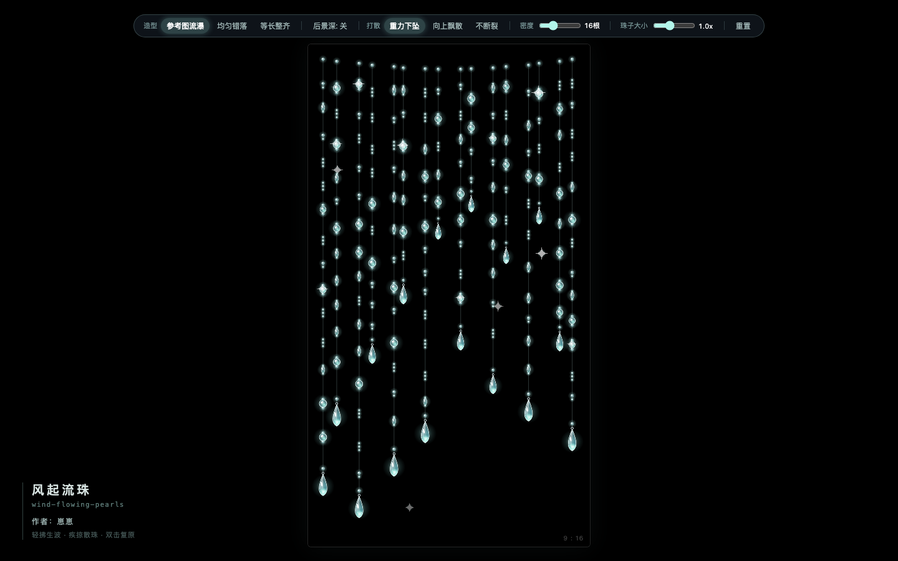

# 风起流珠 (wind-flowing-pearls)

**作者：崽崽**

基于 HTML5 Canvas 与 Verlet 物理引擎的 9:16 竖屏水晶珠帘交互作品。将传统的平面字符门帘重塑为带有体积折射、子母珠结与末端水滴配重的实体水晶珠链。



---

## 核心特性与实现原理

### 1. 离屏水晶光学贴图（3x 超采样）
同屏存在数百颗珠子时，若每帧实时计算径向渐变与阴影，帧率会大幅下跌。项目在启动阶段通过 [`CrystalSprites`](crystal.js) 预先在离屏 Canvas 上绘制 5 类水晶组件与十字星芒，主循环只做 `drawImage` 贴图：
- **微尘露珠（`dew`）**：直径约 3.2px，常以 2~3 颗连缀在长丝中段。
- **小托珠（`spacer`）**：直径约 5.6px，半透明冷白小珠，紧贴在大珠与水滴坠上下两端做珠托。
- **主圆珠（`pearl`）**：直径约 10.6px，包含外层柔光、半透明球体、右下侧薄荷冰翠色焦散反光与左上双高光点。
- **梭形米珠（`olive`）**：纵向拉长的椭圆凝露珠，随丝线切线角度自然偏转。
- **切面水滴吊坠（`teardrop`）**：带内部钻石切面棱线与底部冰翠兜光。长链自动配大水滴，短链配小水滴。

### 2. “长丝留白 + 紧密连珠簇”排布
单根珠链并非等距排满。[`buildSingleChain()`](main.js) 在纵向上交替生成 **24~42px 的裸露银丝留白段** 与 **间距仅 5.5~7px 的子母连珠簇**（如“小托珠—大圆珠—小托珠”、“三连微尘露珠”、“梭形凝露结”），并在链尾以“小托珠 + 切面水滴坠”收束。

### 3. 子母珠质量配重与自适应刚度
- **质量分配**：在 [`BeadNode`](crystal.js) 中，末端水滴坠质量（`2.85`）大于主圆珠（`1.55`）与微尘露珠（`0.65`）。[`Link.resolve()`](crystal.js) 按质量反比分配拉力，使整条珠链自然垂挂时笔直紧绷，拨动时具备尾端坠手惯性。
- **局部刚度**：间距小于 10px 的紧密珠簇自动提高约束刚度，摆动时子母珠结保持整体联动；长丝留白段则按自身长度自适应放大断裂阈值，防止正常重力下误断。

### 4. 三种排布造型与三种打散物理模式
顶部控制栏与 [`CONFIG`](main.js) 支持实时切换：
- **排布造型（`layoutMode`）**：
  - `hat`（参考图流瀑）：顶部呈微弧帽檐线，左右列距成束聚拢与留白交替，左侧长链垂落到底、中右侧短链错落。
  - `staggered`（均匀错落）：左右等距，相邻珠链长短交替。
  - `uniform`（等长整齐）：左右等距，所有珠链末端对齐同一水平线。
- **后景深开关（`enableBackLayer`）**：开启后在前景链缝隙后方生成半透明、偏小的内层短链，受风力时产生前后视差摆动。
- **打散模式（`breakMode`）**：
  - `fall`（重力下坠）：断链后，下半截珠串与碎晶受重力加速下坠并渐隐。
  - `float`（向上飘散）：断链后，脱落的水晶珠与星芒失重向上飘散消融。
  - `unbreakable`（不断裂）：关闭断裂判定，快速划过时掀起大幅波浪并激起星芒闪烁。

---

## 参数配置表

所有默认参数均集中在 [`main.js`](main.js) 顶部的 `CONFIG` 对象中：

| 参数名 | 默认值 | 取值范围 / 可选值 | 说明 |
| :--- | :--- | :--- | :--- |
| `layoutMode` | `'hat'` | `'hat'` \| `'staggered'` \| `'uniform'` | 珠链整体排布造型 |
| `enableBackLayer` | `false` | `true` \| `false` | 是否开启后景半透明衬底珠链 |
| `breakMode` | `'fall'` | `'fall'` \| `'float'` \| `'unbreakable'` | 快速划过或拉扯时的打散物理模式 |
| `chainCount` | `16` | `6 ~ 40` | 9:16 画布内垂坠的链条总根数 |
| `beadScale` | `1.0` | `0.15 ~ 2.5` | 珠子与水滴坠整体大小缩放倍率 |
| `gravity` | `0.34` | `0.05 ~ 1.2` | 垂直重力加速度 |
| `stiffness` | `0.88` | `0.3 ~ 1.0` | 珠链距离约束刚度 |
| `damping` | `0.976` | `0.90 ~ 0.995` | 摆动空气阻尼 |
| `mouseRadius` | `115` | `50 ~ 240` | 鼠标风场推力作用半径 (px) |
| `breakThreshold` | `76` | `40 ~ 180` | 珠链拉断基础临界距离 (px) |

---

## 文件结构与运行方式

```text
wind-flowing-pearls/
├── index.html      # 页面入口（9:16 画布容器、顶部控制栏、左下侧项目展签）
├── crystal.js      # 5 类离屏水晶光学贴图、配重节点 BeadNode、约束 Link、散落粒子 CrystalParticle
├── main.js         # CONFIG 配置项、串珠拓扑生成、风场交互、动态星芒渲染与清音合成
├── preview.png     # 实机运行预览图
└── README.md       # 项目说明文档
```

**运行方法**：直接双击 [`index.html`](index.html) 在浏览器中打开即可运行，无需安装任何依赖或构建工具。
